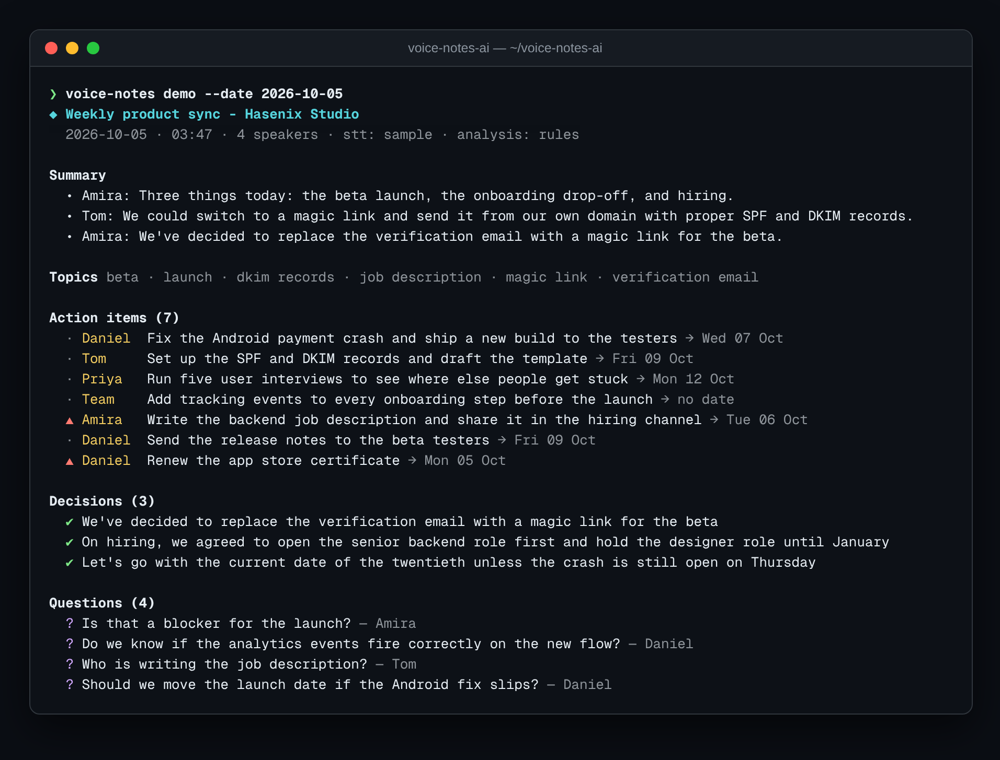

<div align="center">

# 🎙️ voice-notes-ai

**Turn meeting recordings or transcripts into a summary, decisions and owner-assigned action items with resolved due dates.**

[](https://github.com/hbtabi/voice-notes-ai/actions/workflows/ci.yml)


-412991?logo=openai&logoColor=white)

[](LICENSE)

</div>

After a call, everyone remembers the conversation and nobody remembers who agreed to do what by when.
**voice-notes-ai** is a small pipeline that goes from **audio → transcript → structured notes**:

1. **Transcribe** with local Whisper (`faster-whisper` or `openai-whisper`), any OpenAI-compatible
   `/audio/transcriptions` endpoint, or skip it entirely by passing a `.txt` / `.srt` / `.vtt` transcript.
2. **Analyse** with a transparent rule engine (offline, zero dependencies) or an LLM that returns the same JSON shape.
3. **Render** to a terminal view, Markdown meeting notes, or JSON for automation.

No engine installed and no API key? It still runs end-to-end on a **bundled sample meeting**, so you can try it in seconds.

## 📸 Demo

<p align="center"></p>

Generated Markdown: [`examples/sample-notes.md`](examples/sample-notes.md) · [`examples/standup-notes.md`](examples/standup-notes.md)

## ✨ Features

- **Pluggable speech-to-text** with an `auto` chain: faster-whisper → openai-whisper → API → sample fallback (`voice-notes engines` shows what is available)
- **Transcript parsers** for `[00:01:02] Name: text` notes, SRT and WebVTT (including `<v Speaker>` voice tags)
- **Action items with owners**: self-commitments ("I'll…"), requests ("Tom, can you…?"), delegations ("Daniel to…"), explicit `Action item:` lines and team tasks ("we need to…")
- **Due-date resolution**: "by Wednesday", "tomorrow", "end of the week", "next Friday", "12 November" → ISO dates relative to the meeting date
- **Smart merging**: a request and its acknowledgement become one task; urgency words and near deadlines raise priority
- **Decisions, questions (with the reply that followed), topics, talk-time share** and an extractive summary
- **Optional LLM analysis** via any OpenAI-compatible chat API, with tolerant JSON parsing and automatic fallback to the rules
- **Zero runtime dependencies** — standard library only; Whisper and APIs are opt-in

## 🚀 Quick start

```bash
git clone https://github.com/hbtabi/voice-notes-ai.git && cd voice-notes-ai
python -m venv .venv && source .venv/bin/activate
pip install -e ".[dev]"

voice-notes demo                                   # bundled sample meeting, fully offline
voice-notes process examples/standup.srt -f md     # your own transcript
voice-notes process meeting.wav -o notes.md -f md  # audio (needs an engine, see below)
```

### Transcribing audio

```bash
pip install -e ".[whisper]"          # local faster-whisper (CPU is fine for the base model)
voice-notes engines                  # check what's available
voice-notes process standup.m4a --engine faster-whisper --model small -f md -o notes.md
```

Or use a hosted / self-hosted OpenAI-compatible server:

```bash
export OPENAI_API_KEY=sk-...
export OPENAI_BASE_URL=https://api.openai.com/v1
voice-notes process standup.m4a --engine api --llm -f md
```

| Variable | Default | Purpose |
| --- | --- | --- |
| `OPENAI_API_KEY` | – | Enables `--engine api` and `--llm` |
| `OPENAI_BASE_URL` | `https://api.openai.com/v1` | Any OpenAI-compatible server |
| `VOICENOTES_CHAT_MODEL` | `gpt-4o-mini` | Model for `--llm` analysis |
| `VOICENOTES_STT_MODEL` | `whisper-1` | Remote transcription model |
| `VOICENOTES_WHISPER_MODEL` | `base` | Local Whisper model size |

> Whisper output has no speaker labels, so first-person tasks are assigned to "Speaker". Pass a diarised
> transcript (e.g. from your meeting tool's export) for named owners.

## 🐍 Library use

```python
from datetime import date
from voicenotes import analyse, load_transcript
from voicenotes.render import to_markdown

notes = analyse(load_transcript("examples/standup.srt"), meeting_date=date(2026, 10, 5))
for item in notes.action_items:
    print(item.owner, item.task, item.due, item.priority)
print(to_markdown(notes))
```

## 🗂️ Project structure

```
voice-notes-ai/
├── src/voicenotes/
│   ├── transcribe.py    # engine chain: faster-whisper, whisper, API, sample fallback
│   ├── transcript.py    # Segment/Transcript model; text, SRT and VTT parsers
│   ├── analyse.py       # rule engine: actions, decisions, questions, topics, summary
│   ├── dates.py         # relative due-date detection and resolution
│   ├── llm.py           # stdlib OpenAI-compatible client (chat + multipart transcription)
│   ├── llm_analyse.py   # optional LLM analysis with fallback
│   ├── render.py        # terminal, Markdown and JSON output
│   ├── cli.py           # voice-notes process | demo | engines
│   └── data/sample_meeting.txt
├── examples/            # sample SRT + generated notes
├── tests/               # pytest suite (engines are mocked; no network)
└── .github/workflows/ci.yml
```

## 🧪 Development

```bash
pytest && ruff check .
```

## 🛣️ Roadmap

- [ ] Speaker diarisation (pyannote) to name owners from raw audio
- [ ] Export action items to GitHub Issues, Linear or a calendar (.ics)
- [ ] Live microphone mode with rolling notes
- [ ] Multilingual rules (Urdu, Arabic, Spanish)
- [ ] Accuracy benchmark on a labelled set of meeting transcripts

## 📄 Licence

[MIT](LICENSE) © 2026 Mohammed Hassan bin Tayyeb · Built by [Hasenix](https://github.com/hbtabi) in London.
